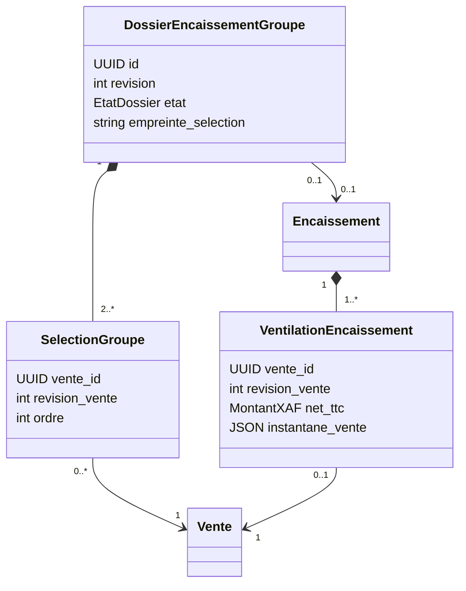
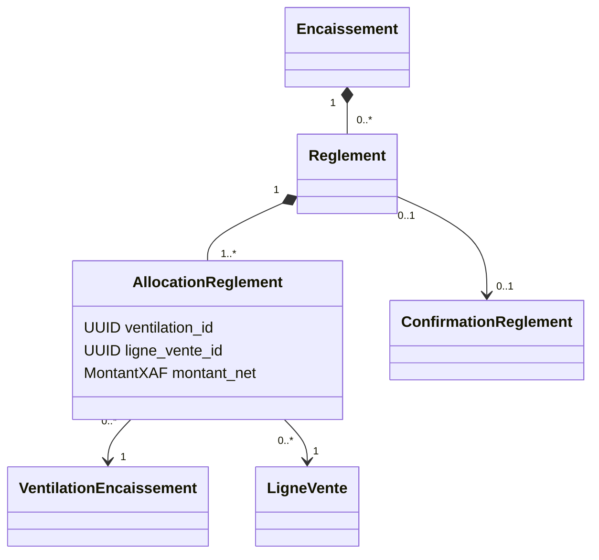

# P4.6 — Étape 3.1 : conception détaillée de l’encaissement groupé

Statut : **proposition technique pour validation, aucune implémentation ni migration**.
Source : `P4_ENCAISSEMENT_GROUPE_CADRAGE.md`, décisions validées dans les échanges et code P4.1–P4.6 existant.

## 1. Intégration préalable de l’ergonomie

La vérification inverse de `finalisation-etape2.patch` réussit dans l’espace de préparation. Cela ne prouve pas l’état du dépôt Windows, auquel cet espace n’a pas accès.

Dans le dépôt Windows, sans application ni inversion du patch :

```powershell
powershell.exe -NoProfile -ExecutionPolicy Bypass -File .\scripts\verifier_patch_encaissement_p46.ps1 -Patch 'C:\chemin\livraison\finalisation-etape2.patch'
```

Codes : 0 = patch intégralement présent ; 2 = applicable mais non appliqué ; 3 = divergence/intégration partielle, arrêter. Le script affiche la branche et l’état Git, puis exécute seulement `git apply --check` et `git apply --reverse --check`. Il ne touche ni aux fichiers, ni à GitHub, ni à PostgreSQL. Si la branche n’est pas `feat/p4-6-comptoir`, il refuse de poursuivre.

La procédure de sauvegarde déjà fournie reste applicable avant toute application autorisée. Aucun `--reject`, remplacement de fichier ou restauration forcée. Les corrections Proformas et les deux panneaux ne sont pas modifiés par l’étape 3.1.

## 2. Périmètre retenu

- L’encaissement individuel et son endpoint restent disponibles.
- Un encaissement groupé concerne au moins deux ventes TRANSMISES, une même organisation, un même site, emplacement, caisse et session ouverte appartenant au caissier.
- Client/titulaire commun identifié explicitement à la caisse ; aucun rapprochement automatique de titulaires. Les préparations actuelles n’identifient pas toutes un client : le regroupement ne doit pas inventer une identité préexistante.
- Un encaissement financier et un numéro d’encaissement par groupe, un reçu commun ; numéros d’appel et UUID individuels conservés.
- Montants et remises de chaque préparation revalidés selon les règles existantes, sans remise supplémentaire de groupe et sans recalcul tarifaire arbitraire.
- Réservations P3 existantes conservées : le dossier de groupe ne crée aucune réservation supplémentaire.
- Crédit, tiers payant et utilisation monétaire des points restent non finalisables.

## 3. Décisions d’architecture et compatibilité

Le modèle actuel `EncaissementModel` possède un `vente_id` obligatoire et unique, des règlements, des mouvements, un instantané, un PDF et son SHA256. P4.5 lit directement ce `vente_id` pour les retours. `ConfirmationReglementModel` est rattachée à une vente ; `JournalFideliteModel` impose un seul mouvement de chaque type par encaissement.

**Choix proposé : conserver Encaissement comme opération financière et étendre son association aux ventes par une ventilation explicite.** Aucun second moteur de caisse, aucune boucle de finalisations individuelles avec commits intermédiaires. L’API individuelle garde ses contrats ; ses traitements internes partageront les vérifications et la finalisation transactionnelle avec le groupe.

Un dossier de groupe révisionné permet de rattacher les confirmations non espèces avant finalisation. Il ne représente ni une nouvelle Vente ni un paiement déjà encaissé. Les anciennes confirmations restent rattachées à leur vente ; elles ne sont ni réécrites ni dupliquées.

## 4. UML proposé





Les règlements peuvent être absents si le net est nul, conformément à la fonction financière existante ; aucune nouvelle règle de montant minimal. La ventilation d’un individuel contient une vente ; celle d’un groupe en contient au moins deux. Le reçu appartient toujours à l’Encaissement, pas à chaque ventilation.

## 5. Données et contraintes proposées

Toutes les nouvelles entités ont un UUID interne et une portée organisation. Les montants restent `MontantXAF`, en FCFA entiers, calculés avec Decimal/entiers, jamais avec float.

| Élément | Données et invariants |
| --- | --- |
| DossierEncaissementGroupe | organisation/site/emplacement/caisse/session, auteur, révision positive, état, compte fidélité facultatif, dates, empreinte canonique de la sélection et des données financières |
| SelectionGroupe | dossier, vente, révision capturée, ordre ; unicité dossier/vente ; aucune vente copiée ; compatibilité organisation et contexte vérifiée |
| VentilationEncaissement | encaissement, vente, révision avant paiement, montants HT/TVA/TTC/remises, instantané produits/lignes/classifications utiles, détails fidélité ; **vente_id unique** pour empêcher un double encaissement |
| AllocationReglement | règlement, ventilation, ligne originale, montant net strictement positif ; unicité règlement/ventilation/ligne ; le règlement et la ventilation appartiennent au même encaissement |
| Encaissement existant | ajout d’un type INDIVIDUEL/GROUPE et d’un dossier facultatif unique ; vente_id conservé pour les individuels historiques mais nullable pour un groupe ; contraintes de forme explicites |
| ConfirmationReglement existante | vente_id ou dossier_groupe_id, exclusivement l’un des deux ; révision de vente ou de dossier correspondante ; session/mode/montant/référence/preuve/source/auteur conservés ; unicité organisation/mode/référence et consommation unique conservées |

Des clés étrangères composites vérifient la portée organisation et l’appartenance encaissement/règlement/ventilation/ligne/vente. Les sommes interlignes ne sont pas de simples CHECK SQL : elles seront recontrôlées dans le service et par des contraintes différées PostgreSQL sur les nouvelles allocations. Le niveau exact de ces contraintes sera présenté avec la migration.

Égalités après validation : somme des ventilations = total encaissé ; somme des allocations par règlement = montant reçu − rendu ; somme par vente/ligne = net historique correspondant. Aucun surpaiement non espèces, aucun rendu non espèces, aucun dépassement d’origine lors d’un remboursement.

Ventilations, allocations, confirmations et journaux financiers sont immuables après émission ; les corrections utilisent les mécanismes compensatoires existants. Les dossiers de sélection ne sont modifiables que selon les règles ci-dessous.

## 6. Cycle du dossier et confirmations

États proposés : BROUILLON → EN_REGLEMENT → ENCAISSE ; ANNULE lorsque les conditions d’annulation sont satisfaites. BROUILLON peut être finalisé directement en espèces, dans la transaction atomique.

- Avant un paiement acquis : sélection modifiable, révision et empreinte incrémentées, aucun effet stock.
- Première confirmation non espèces : EN_REGLEMENT ; la liste des ventes est figée. Une vente ou remise modifiée invalide la compatibilité financière, sans effacer la preuve du paiement acquis.
- Rapprochement : autorisation existante de confirmation, justification et événement immuable, nouvelle révision/empreinte contrôlée. Aucun transfert silencieux de preuve entre dossiers.
- Annulation : aucun paiement acquis non consommé ne doit être abandonné. Les restitutions passent par P4.5, avec preuve et idempotence ; une annulation de dossier n’est jamais une preuve de remboursement.
- Clôture Z : inclure les confirmations de groupes acquises non finalisées dans les blocages existants. Les dossiers inachevés sont annulés de façon tracée après résolution ; les réservations des ventes sont libérées par le circuit Z existant, une seule fois.

**Atomicité locale ≠ effacement d’un paiement externe réellement acquis.** Un échec de finalisation annule toutes ses écritures locales ; les confirmations déjà enregistrées restent à rapprocher ou restituer. Aucun connecteur bancaire simulé.

## 7. Paiements mixtes et ventilation déterministe

Réutiliser les moyens activés et `repartir_paiements` pour le total : intégralité réglée, monnaie uniquement sur espèces. Garder l’ordre explicite des règlements dans le contrat et l’empreinte d’idempotence.

1. Toute confirmation historique individuelle est ancrée à sa vente d’origine. Son montant ne peut pas être déplacé vers une autre vente par le seul regroupement. Si les paiements ancrés dépassent son net, refuser et résoudre avec preuve.
2. Les règlements confirmés pour le groupe et les espèces sont répartis sur les soldes restants des lignes après remises : prorata entier, fractions résiduelles distribuées par plus grand reste, égalités départagées par UUID vente puis UUID ligne.
3. Mettre à jour les soldes restants après chaque règlement. Enregistrer chaque allocation avec le moyen et la confirmation accessibles via son règlement parent.
4. Conserver les montants reçus, le rendu et les montants nets séparément. La matrice finale est historisée, jamais recalculée lors d’un retour.

Exemple : ventes A=101 et B=99, carte groupe=100 et espèces reçues=120. Total=200, rendu espèces=20. La carte peut être allouée 51/49 selon le départage stable ; les espèces nettes 50/50. La somme reste 101/99 et les mouvements nets totalisent 200. Cet exemple ne définit aucun nouveau taux de fidélité.

## 8. Fidélité et retours : invariants inchangés

Calculer l’acquisition **par vente** avec son montant éligible payé après remises et son barème applicable, puis sommer les résultats entiers. Ne pas arrondir une base groupée : cela changerait les règles existantes. Aucun taux implicite, aucun report de fractions et aucune utilisation monétaire de points.

Verrouiller le compte commun ; agréger crédit et compensation de dette dans la transaction. Un journal ACQUISITION par encaissement conserve les détails par ventilation, compatible avec l’unicité encaissement/type actuelle. La compensation de dette est ventilée dans un ordre stable, sans affecter le total des points ; sa règle sera explicitée et testée dans l’implémentation. Révision du compte actualisée une fois pour l’opération groupée.

Un retour désigne l’encaissement commun **et la ventilation/vente concernée**, puis ses lignes originales. Les droits sont vérifiés sur cette vente. Les remboursements prioritaires par moyen d’origine utilisent les allocations de ses lignes et les montants déjà remboursés, pas l’ensemble du paiement du groupe. Les quantités, HT/TVA historiques, régularisations cumulatives de points et dettes P4.5 restent applicables à la vente concernée.

La finalisation groupée ne sera pas ouverte aux utilisateurs tant que les adaptations retours/remboursements/fidélité/Z ne sont pas vérifiées. Aucun changement requis dans les règles métier P1–P3 ; les services de réservations P3 sont réutilisés.

## 9. Contrats API proposés

Préfixe existant `/api/caisses/organisations/{organisation_id}`. Tous les UUID sont internes. Mutations : CSRF, session authentifiée, clé d’idempotence `cle`, permissions et contexte P1. Aucun identifiant libre ne remplace une vente ou une ligne.

| Route future | Contrat / effet |
| --- | --- |
| POST /encaissements-groupes/previsualiser | ventes [{vente_id, revision}], session_id, revision_session, compte_id/revision_compte facultatifs ; réponse totale, lignes, blocages, empreinte ; lecture sans réservation ni paiement |
| POST /encaissements-groupes | mêmes références + cle ; création du dossier révisionné, aucun encaissement |
| GET /encaissements-groupes/{id} | dossier, révision, ventes, confirmations et blocages autorisés |
| PUT /encaissements-groupes/{id}/selection | cle, revision_dossier, ventes/révisions ; uniquement avant paiement acquis, sinon 409 |
| POST /encaissements-groupes/{id}/confirmations | cle, revision_dossier, empreinte, session/révision, mode, montant, référence, preuve, source manuelle ; confirmation indépendante, pas de finalisation |
| POST /encaissements-groupes/{id}/confirmations/{confirmation_id}/rapprocher | cle, revision_dossier, révisions des ventes/session, justification ; compatibilité révalidée et trace immuable |
| POST /encaissements-groupes/{id}/finaliser | cle, revision_dossier, empreinte, ventes/révisions, session/révision, règlements, compte/révision, points_utilises=0 ; une transaction financière |
| POST /encaissements-groupes/{id}/annuler | cle, revision_dossier, justification ; refus tant qu’un paiement acquis n’est pas résolu |
| GET /recus/{id}, /recus/{id}/pdf | routes conservées, lecture compatible des versions historiques et groupées |
| GET /ventes/{id}/encaissement | lien vers encaissement/reçu et ventilation de cette vente ; complément proposé, pas remplacement du parcours individuel |

Réponse de finalisation : id_encaissement, type, numero_encaissement, total_xaf, rendu_especes, ventilations [{id, vente_id, montants, allocations}], fidelite, référence PDF. Instantané `schema_version=2` pour un groupe, lecteur conservé de la version historique. Les réponses anciennes de finalisation individuelle gardent leur forme actuelle ; les métadonnées nouvelles sont additives.

Exemple de demande finale :

```json
{
  "cle": "UUID_OPERATION",
  "revision_dossier": 3,
  "empreinte": "SHA256_SELECTION_FINANCIERE",
  "ventes": [{"vente_id": "UUID_A", "revision": 4}, {"vente_id": "UUID_B", "revision": 7}],
  "session_id": "UUID_SESSION",
  "revision_session": 6,
  "reglements": [{"mode": "CARTE", "montant": "100", "confirmation_id": "UUID_PREUVE"}, {"mode": "ESPECES", "montant": "120"}],
  "compte_id": null,
  "revision_compte": null,
  "points_utilises": 0
}
```

Codes : 401 sans authentification ; 403 droits/contexte incompatibles, dont CSRF selon les règles existantes ; 404 objet absent ou inaccessible selon la politique actuelle ; 409 révision, état, paiement ou sélection incompatible ; 422 saisies/montants invalides. Aucun total partiel divulgué pour une vente non autorisée.

Permission dédiée proposée : `caisse.encaisser.groupe`, sans affectation automatique. La finalisation exige **caisse.encaisser ET caisse.encaisser.groupe**, sur chaque vente et la session. Attention : les tuples de POLICY existants expriment des alternatives ; il faut des vérifications explicites conjointes, pas un tuple supposé signifier AND. Confirmer un paiement exige en plus `caisse.paiement.confirmer` ; identifier un titulaire exige `fidelite.consulter`.

## 10. Transaction et concurrence

Conserver `StockService.operation` et son verrou organisation partagé par les opérations existantes : idempotence acteur/clé/empreinte, résultat mémorisé et un seul commit. Ne pas remplacer ce verrou par une optimisation concurrente lors de cet incrément.

Ordre : contrôles d’accès avant rejeu → verrou organisation → dossier/session/période Z → ventes triées par UUID → réservations/stocks → confirmations → compte fidélité. Des verrous de lignes complémentaires peuvent être ajoutés dans cet ordre sans contourner le verrou partagé.

Dans la transaction : relire toutes les révisions et états, vérifier caisse/session/modes/remises/plafonds, confirmations acquises/restaurées, réservations et péremptions ; calculer les ventilations ; consommer toutes les réservations ; attribuer un numéro ; enregistrer encaissement, ventilations, règlements, allocations, mouvements nets, fidélité, PDF/SHA256 et événements ; passer toutes les ventes à ENCAISSEE, incrémenter leurs révisions et celle de la session ; enregistrer le résultat idempotent ; commit.

Tout échec, y compris génération PDF ou dernière réservation invalide : rollback complet. Pas de génération asynchrone donnant un succès avant disponibilité du reçu. Un rejeu avec même clé/acteur/contenu rend le même résultat après nouveau contrôle des droits ; clé réutilisée pour un autre contenu → 409. Les courses groupe/groupe, groupe/individuel, groupe/Z sont sérialisées par les verrous existants et les unicités nouvelles.

## 11. Migration compatible — stratégie, pas fichiers Alembic

Prévoir une phase d’expansion : nouvelles tables, colonnes facultatives, contraintes et index. L’actuel head reste `a46c001d2026` ; aucune révision nouvelle n’est créée dans cette étape.

- Ajouter dossiers/sélections/ventilations/allocations et liens de portée organisation.
- Garder les colonnes historiques ; rendre vente_id de l’Encaissement nullable uniquement avec une contrainte de forme permettant les groupes. Conserver l’unicité historique vente_id et ajouter l’unicité vente sur la ventilation.
- Étendre les confirmations avec une portée vente OU dossier et leurs révisions compatibles. Ne modifier aucune ancienne confirmation.
- Ajouter un lien facultatif de ventilation au RetourVente ; les anciens retours restent résolus par leur encaissement individuel. Adapter les remboursements des confirmations groupées, sans toucher aux anciennes preuves.
- Aucun UPDATE des anciens encaissements, règlements, PDF ou journaux immuables. Pas de désactivation de leurs triggers.
- Pour les historiques, le lecteur fabrique une vue de ventilation depuis le lien vente_id et l’instantané conservé ; pas de fausse allocation réécrite dans l’historique. Les montants disponibles sont exploités selon leur précision réelle.
- Les nouveaux encaissements individuels insèrent aussi leur ventilation ; l’interdiction d’une vente déjà historiquement encaissée vérifie la table existante et la nouvelle association sous le même verrou. Une contrainte PostgreSQL complémentaire couvre les deux représentations et refuse des identifiants d’encaissement différents pour une même vente ; le double lien historique/ventilation du même encaissement individuel reste valide. Ne pas se contenter de deux index isolés.
- Si un ancien reçu n’a pas de détail suffisant pour une allocation par ligne, conserver sa logique P4.5 historique ; ne pas inventer une ventilation financière passée.
- Downgrade autorisé seulement en l’absence de données nouvelles. Après encaissements groupés, refuser un downgrade destructif ; privilégier correction en avant ou restauration d’une sauvegarde isolée vérifiée.

Validation future, uniquement après autorisation : bases PostgreSQL jetables, upgrade/check/downgrade/upgrade sur schéma neuf, puis copie fictive au head actuel avec données individuelles pour vérifier compatibilité et intégrité des hashes PDF. Aucun essai sur `neosys_pharma_v1` ou modification de la recette humaine existante.

## 12. Préparation P5, sans P5

La ventilation par vente/ligne sépare le montant commercial historique du règlement reçu et de son allocation. Prévoir une extension de créances/parts et d’organismes ultérieurement, sans créer maintenant une entité CNAMGS, une couverture, un taux, un ordre de complémentaires ou une créance.

Dans cette version, la part réglable reste intégralement client pour SANS_TIERS. Les instantanés versionnés et identifiants de vente/ligne permettent d’ajouter une ventilation par débiteur en P5 sans réinterpréter les paiements historiques. L’encaissement groupé ne transforme jamais une prise en charge attendue en règlement acquis.

## 13. Découpage et validations futures

1. **3.1 actuelle** : document, UML, contrats et contrôle non destructif du patch ; arrêt pour validation.
2. **3.2** : domaine et persistance, migrations d’expansion présentées avant exécution ; tests unitaires de ventilation et schémas isolés.
3. **3.3** : dossier, confirmations, transaction unique et API ; tests HTTP/isolation/CSRF, concurrence et rollback sur données jetables.
4. **3.4** : adaptations retours/remboursements/fidélité/Z, compatibilité individuelle et historique ; groupe non ouvert tant que ces contrôles manquent.
5. **3.5** : sélection multiple au clavier dans la file paginée, récapitulatif, confirmation et reçu unique multi-pages ; pas de chargement massif au DOM.
6. **3.6** : recette humaine fictive des seuls nouveaux scénarios, puis autorisation séparée de recette complète si nécessaire.

Matrice ciblée : groupes de 2/N ventes, paiements mixtes/ancrés, égalités d’arrondi, net nul, sélection périmée, session fermée, droits révoqués, confirmation déjà consommée/restaurée, réservations expirées, dernière ligne en échec, rejeu, courses groupe/individuel/Z, points par vente et dette, retour partiel sur une seule vente du groupe, deux remboursements concurrents, anciens PDF identiques octet pour octet, aucun double comptage dans X/Z.

## 14. Fichiers concernés

**Préparés maintenant :** ce document et `scripts/verifier_patch_encaissement_p46.ps1`. Aucun fichier métier, API, migration ou interface modifié.

**Futurs, après validation :** `domain/caisse.py`, services encaissement/vente/régularisation (adaptations ciblées), `infrastructure/caisse_models.py`, `regularisation_models.py`, nouvelles migrations, rendu PDF compatible, `presentation/caisse_api.py`, `web/caisse.js` et grille de sélection, tests ciblés métier/API/PostgreSQL/Chromium, documentation P4. Pas de modification métier P1–P3 ni de développement P5.

Points techniques à approuver : association multi-ventes, dossier révisionné pour confirmations, extension compatible des tables existantes, ventilation par ligne, journal fidélité agrégé détaillé par vente, permission dédiée et blocage du downgrade après nouvelles données. Les contrats restent une proposition tant que cette conception n’est pas validée.
