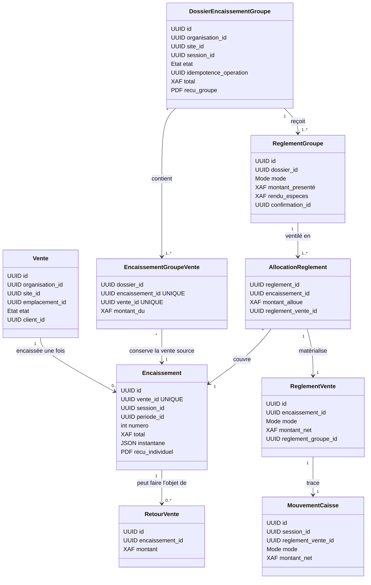

# P4-C — Conception ciblée de l’encaissement groupé

**État : proposition de conception, en attente des décisions métier ci-dessous.**
Ce document ne modifie aucun service, modèle SQL ou migration.

## Périmètre et composants réutilisables

- `domain/vente.py` : états et transitions existants ; une vente encaissée est terminale.
- `application/caisse_service.py` : contrôle d’une vente transmise, d’une session ouverte,
  des modes autorisés, des confirmations non espèces, des réservations, du stock, de la
  fidélité, des règlements, des mouvements et du reçu individuel.
- `domain/caisse.py` et `infrastructure/montant_xaf.py` : montants XAF entiers, calcul de
  rendu espèces, acquisition et régularisation des points.
- `infrastructure/caisse_models.py` : `EncaissementModel` a déjà une contrainte unique
  sur `vente_id`; les règlements, mouvements et journaux financiers sont append-only.
- `StockService.operation()` et `StockRepository.verrouiller()` : empreinte de requête
  pour l’idempotence, détection d’une clé réutilisée avec un autre contenu, et verrou
  transactionnel PostgreSQL sur l’organisation.
- `application/regularisation_service.py` et `infrastructure/regularisation_models.py` :
  retours et remboursements sont rattachés à l’encaissement d’une vente; les clôtures
  agrègent les mouvements de caisse par mode.
- `presentation/caisse_api.py` : permissions, session, contexte organisation/site et
  périmètre d’emplacements sont contrôlés sur le circuit individuel.
- P4-B apporte les fiches clients autonomes, organismes de prise en charge et historique
  client (`client_models.py`, `client_api.py`, migration `20261015_01`). Un encaissement
  P4-C conservera les références client de chaque vente sans calcul de prise en charge P5.

`GROUPED_ENCASHMENT_ENABLED` et toute interface ne sont pas modifiés dans cette étape.

## Diagramme UML proposé

Le diagramme conserve un encaissement comptable par vente, afin de réutiliser l’unicité
`caisse_encaissements.vente_id`, l’historique, les retours et les règles de fidélité. Un
dossier de groupe porte le reçu collectif et relie ces encaissements. Chaque ligne de
règlement est ventilée vers une ou plusieurs ventes.

Les noms représentent les concepts, pas encore les noms définitifs des tables. Les
confirmations non espèces groupées doivent être modélisées sans contourner les
confirmations existantes ni réutiliser une confirmation individuelle pour plusieurs
ventes. Les références de P4-B restent attachées à chaque vente ; aucun attribut de
prise en charge n’est calculé dans ce périmètre.

## Transaction et invariants proposés

1. Le point d’entrée requiert les permissions existantes `caisse.encaisser` et, pour une
   confirmation externe, `caisse.paiement.confirmer`. Aucune permission n’est attribuée
   implicitement.
2. Le dossier ne regroupe que des ventes `TRANSMISE`, `SANS_TIERS`, couvertes par la même
   session ouverte et son caissier courant, la même organisation, le site et les
   emplacements déjà autorisés. Toute exception à ce périmètre est à décider.
3. Une clé d’idempotence est liée à l’organisation, à l’auteur, au type d’opération et à
   l’empreinte canonique du contenu. Même clé/même contenu rejoue le résultat; même
   clé/contenu différent produit un conflit explicite.
4. Dans une transaction PostgreSQL unique : verrouiller les ventes dans un ordre
   déterministe, revalider leur état/révision, session, confirmations, soldes, réserves,
   barèmes et compte fidélité; puis écrire le groupe, les encaissements par vente,
   règlements/allocation, mouvements, fidélité, numéros, reçus et événements; enfin
   passer les ventes à `ENCAISSEE` et valider.
5. `UNIQUE(caisse_encaissements.vente_id)` reste la barrière de dernier ressort commune
   aux parcours individuel et groupé. Le groupe produit un `Encaissement` par vente;
   aucun changement du parcours individuel n’est requis pour cette barrière.
6. Un échec avant commit annule l’intégralité de ces écritures. Les séquences de reçus
   doivent rester cohérentes avec la stratégie de numérotation retenue et les contraintes
   PostgreSQL, sans numéro attribué par compteur non verrouillé.
7. Les mouvements de caisse restent des écritures immuables. Les clôtures continuent à
   agréger une seule fois le net par mode; les reçus de groupe et les reçus par vente
   restent reliés et consultables sous les permissions courantes.

Les règles des points restent celles de P4.5 par vente. Les opérations de stock et les
états de vente restent dans la transaction finale et ne sont pas refaits par une seconde
logique de groupe.

## Migration additive envisagée — après décisions

Une migration suivant `20261015_01` ajouterait le dossier, ses ventes, règlements et
allocations, plus les références nécessaires pour lier les règlements de vente aux
lignes de règlement groupées. Toutes les clés étrangères porteraient l’organisation
pour conserver les protections inter-organisations. Les états seraient contraints par
`CHECK`, les totaux positifs et les associations uniques par `UNIQUE`; les écritures
historiques seraient immuables après finalisation.

Aucune migration historique ne sera réécrite. La migration proposée doit conserver
`UNIQUE(caisse_encaissements.vente_id)` et les contraintes existantes sur références de
confirmation. Si la décision de confirmation groupée nécessite une évolution d’une
contrainte existante, cette évolution sera explicitement additive (nouvelle colonne ou
table, contrainte ajustée par migration réversible) et couverte par tests PostgreSQL
jetables avant toute activation.

## Décisions métier attendues

1. **Allocation** — répartition automatique par défaut, manuelle, ou choix au dossier ?
   Si automatique : ordre de priorité (ordre des tickets, espèces d’abord, autres moyens,
   prorata) et traitement d’un règlement insuffisant. Le système ne modifiera pas une
   ventilation manuelle sans l’accord explicite du caissier.
2. **Équilibre et espèces** — le total doit-il couvrir exactement les parts dues ?
   L’excédent espèces est-il rendu comme dans P4.5 et comment le rendu s’affecte-t-il au
   reçu de groupe ? Tout excédent non espèces reste interdit sauf décision contraire.
3. **Arrondis** — les montants de règlement sont en XAF entiers aujourd’hui. Confirmer
   que les allocations suivent cette unité; si une ventilation proportionnelle crée un
   reste, définir l’ordre déterministe de distribution de chaque franc.
4. **Confirmations externes** — une confirmation carte/mobile/chèque/virement est-elle
   portée une fois au niveau du groupe, puis ventilée, ou faut-il une confirmation
   distincte par vente ? Définir les références et preuves exigées sans simuler de
   prestataire bancaire.
5. **Retours et remboursements** — un retour reste attaché à une seule vente; faut-il
   rembourser par retour dans les moyens initialement alloués à cette vente, permettre
   un moyen substitué sous permission, ou rembourser selon la ventilation d’origine ?
   Confirmer si plusieurs remboursements partiels successifs par retour sont requis.
6. **Fidélité** — confirmation de l’acquisition et de la compensation par vente, en
   appliquant les règles de retours P4.5 existantes. Confirmer qu’un client différent
   par vente est autorisé et que les points ne sont jamais calculés sur le total agrégé.
7. **Reçus et numérotation** — un seul document remis au client ou également un reçu
   individuel par vente ? Les ventes gardent leurs numéros individuels actuels; définir
   si le groupe obtient un numéro séparé et comment les deux références apparaissent.
8. **Cycle du dossier** — le groupe peut-il être préparé et abandonné avant règlement ?
   Une vente peut-elle appartenir à plusieurs dossiers brouillons ? Définir l’expiration,
   l’annulation et les conflits quand un dossier concurrent encaisse la vente.
9. **Périmètre opérationnel** — confirmer que tous les tickets doivent partager la
   même session, le même site et le même emplacement de caisse, conformément au parcours
   actuel.

## Risques / tests bloquants avant activation

- Concurrence PostgreSQL native obligatoire pour groupe/groupe, individuel/groupe,
  double finalisation et idempotence (même et différente empreinte), avec timeouts bornés.
- Vérifier le rollback complet avant commit : une seule vente ne doit pas être encaissée
  si un autre membre échoue.
- Régressions ciblées X/Z, total par mode, mouvements, retours/remboursements, fidélité,
  reçus historiques individuels et accès par organisation/site/emplacement.
- Migrations et tests uniquement sur une base PostgreSQL explicitement jetable; aucune
  activation de `GROUPED_ENCASHMENT_ENABLED` avant les recettes complètes.
