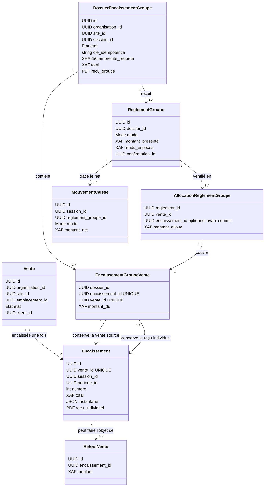

# P4-C — Conception ciblée de l’encaissement groupé

**État : décisions métier validées ; modèle/persistance P4-C.2 en cours de livraison.**
L’interface et l’orchestration transactionnelle restent hors périmètre de cet incrément.

## Périmètre et composants réutilisables

- `domain/vente.py` : états et transitions existants ; une vente encaissée est terminale.
- `application/caisse_service.py` : contrôle d’une vente transmise, d’une session ouverte,
  des modes autorisés, des confirmations non espèces, des réservations, du stock, de la
  fidélité, des règlements, des mouvements et du reçu individuel.
- `domain/caisse.py` et `infrastructure/montant_xaf.py` : montants XAF entiers, calcul de
  rendu espèces, acquisition et régularisation des points.
- `infrastructure/caisse_models.py` : `EncaissementModel` a déjà une contrainte unique
  sur `vente_id`; les règlements, mouvements et journaux financiers sont append-only.
- `StockService.operation()` et `StockRepository.verrouiller()` : empreinte de requête
  pour l’idempotence, détection d’une clé réutilisée avec un autre contenu, et verrou
  transactionnel PostgreSQL sur l’organisation.
- `application/regularisation_service.py` et `infrastructure/regularisation_models.py` :
  retours et remboursements sont rattachés à l’encaissement d’une vente; les clôtures
  agrègent les mouvements de caisse par mode.
- `presentation/caisse_api.py` : permissions, session, contexte organisation/site et
  périmètre d’emplacements sont contrôlés sur le circuit individuel.
- P4-B apporte les fiches clients autonomes, organismes de prise en charge et historique
  client (`client_models.py`, `client_api.py`, migration `20261015_01`). Un encaissement
  P4-C conservera les références client de chaque vente sans calcul de prise en charge P5.

`GROUPED_ENCASHMENT_ENABLED` et toute interface ne sont pas modifiés dans cette étape.

## Diagramme UML

Le diagramme conserve un encaissement comptable par vente, afin de réutiliser l’unicité
`caisse_encaissements.vente_id`, l’historique, les retours et les règles de fidélité. Un
dossier de groupe porte le reçu collectif et relie ces encaissements. Chaque ligne de
règlement est ventilée vers une ou plusieurs ventes.

Les noms de tables sont définis dans la migration P4-C.2. Les références de confirmation
restent celles de P4.5 ; le service P4-C.3 vérifiera leur session, mode, montant et
consommation croisée avec les règlements individuels. Les références client P4-B restent
attachées à chaque vente ; aucun attribut de prise en charge n’est calculé ici.

## Transaction et invariants proposés

1. Le point d’entrée requiert les permissions existantes `caisse.encaisser` et, pour une
   confirmation externe, `caisse.paiement.confirmer`. Aucune permission n’est attribuée
   implicitement.
2. Le dossier ne regroupe que des ventes `TRANSMISE`, `SANS_TIERS`, couvertes par la même
   session ouverte et son caissier courant, la même organisation, le site et les
   emplacements déjà autorisés. Toute exception à ce périmètre est à décider.
3. Une clé d’idempotence est unique dans l’organisation et liée à l’empreinte canonique
   du contenu. Même clé/même contenu rejoue le résultat; même clé/contenu différent
   produit un conflit explicite. Le schéma enregistre la clé et le SHA-256 sur le dossier
   finalisé ; le service doit comparer l’empreinte avant de restituer le reçu.
4. Dans une transaction PostgreSQL unique : verrouiller les ventes dans un ordre
   déterministe, revalider leur état/révision, session, confirmations, soldes, réserves,
   barèmes et compte fidélité; puis écrire le groupe, les encaissements par vente,
   règlements/allocation, mouvements, fidélité, numéros, reçus et événements; enfin
   passer les ventes à `ENCAISSEE` et valider.
5. `UNIQUE(caisse_encaissements.vente_id)` reste la barrière de dernier ressort commune
   aux parcours individuel et groupé. Le groupe produit un `Encaissement` par vente;
   aucun changement du parcours individuel n’est requis pour cette barrière.
6. Un échec avant commit annule l’intégralité de ces écritures. Les séquences de reçus
   doivent rester cohérentes avec la stratégie de numérotation retenue et les contraintes
   PostgreSQL, sans numéro attribué par compteur non verrouillé.
7. Les mouvements de caisse restent des écritures immuables. Les clôtures continuent à
   agréger une seule fois le net par mode; les reçus de groupe et les reçus par vente
   restent reliés et consultables sous les permissions courantes.

Les règles des points restent celles de P4.5 par vente. Les opérations de stock et les
états de vente restent dans la transaction finale et ne sont pas refaits par une seconde
logique de groupe.

## Modèle et migration additive P4-C.2

`20261015_02` suit `20261015_01`. Elle ajoute le dossier, les ventes membres, les
règlements, les allocations, les mouvements nets et un compteur de reçu collectif
distinct. Les clés étrangères organisationnelles et site empêchent les associations
hors périmètre. Les contraintes `CHECK`, `UNIQUE` et les index couvrent les montants
XAF entiers, les références, l’idempotence et les liaisons entre dossier, règlements,
ventes et encaissements individuels. Les mouvements groupés sont immuables. Un brouillon
ne porte ni reçu, ni numéro, ni clé finale d’idempotence.

Les sommes d’allocations, les montants agrégés, l’état de session, la correspondance
confirmation/session/mode/montant, l’état/révision des ventes et le lien entre allocations
et encaissements sont des invariants multi-lignes. Ils seront vérifiés sous verrous dans
la transaction de finalisation P4-C.3 ; un `CHECK` de ligne ne peut pas les garantir seul.

Aucune migration historique ne sera réécrite. La migration proposée doit conserver
`UNIQUE(caisse_encaissements.vente_id)` et les contraintes existantes sur références de
confirmation. Si la décision de confirmation groupée nécessite une évolution d’une
contrainte existante, cette évolution sera explicitement additive (nouvelle colonne ou
table, contrainte ajustée par migration réversible) et couverte par tests PostgreSQL
jetables avant toute activation.

## Règles métier validées

1. Répartition automatique par ordre fixe des tickets ; corrections manuelles possibles
   sans réparation silencieuse. Une couverture incomplète bloque la finalisation.
2. Rendu uniquement en espèces ; rendu tracé et mouvements calculés sur le net. Aucun
   excédent non espèces.
3. XAF entiers uniquement ; tout franc restant suit l’ordre déterministe des tickets.
4. Une confirmation par règlement groupé non espèces, reliée aux allocations et jamais
   consommée deux fois. Les contrôles P4.5 restent requis.
5. Chaque retour reste associé à sa vente. Le remboursement suit les moyens initialement
   alloués ; substitution seulement avec permission et justification. Les remboursements
   partiels successifs restent bornés au solde.
6. La fidélité est calculée et régularisée par vente, même si les clients diffèrent.
7. Reçu collectif et reçus individuels distincts, avec une numérotation groupe séparée
   par période de caisse.
8. Brouillons modifiables ou abandonnables sans réserver définitivement les ventes ;
   ventes et révisions sont revérifiées à la finalisation.
9. Même organisation, site et session ouverte ; emplacements de stock distincts admis
   s’ils sont autorisés. Les permissions existantes restent obligatoires.

## Risques / tests bloquants avant activation

- Concurrence PostgreSQL native obligatoire pour groupe/groupe, individuel/groupe,
  double finalisation et idempotence (même et différente empreinte), avec timeouts bornés.
- Vérifier le rollback complet avant commit : une seule vente ne doit pas être encaissée
  si un autre membre échoue.
- Régressions ciblées X/Z, total par mode, mouvements, retours/remboursements, fidélité,
  reçus historiques individuels et accès par organisation/site/emplacement.
- Migrations et tests uniquement sur une base PostgreSQL explicitement jetable; aucune
  activation de `GROUPED_ENCASHMENT_ENABLED` avant les recettes complètes.
