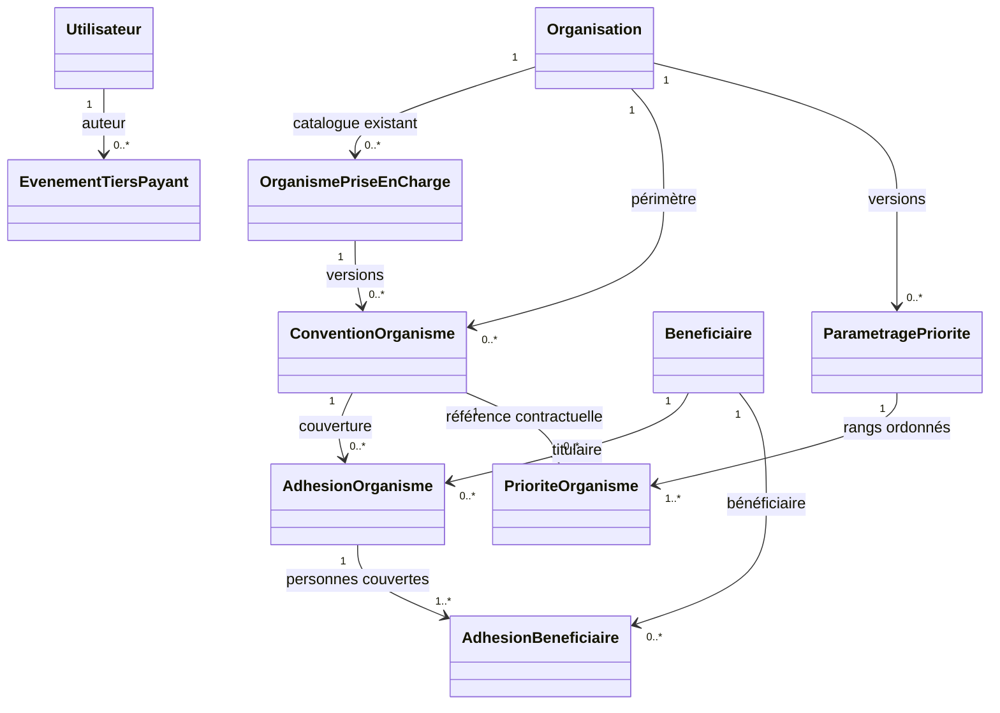

# P5-A — Référentiel des tiers payants

## Portée

Ce lot ajoute les fondations de consultation et d'administration des conventions, des bénéficiaires/adhésions et des priorités d'organismes. Il ne calcule aucune part, aucun plafond, aucune exclusion ni aucune créance. Le calcul ligne par ligne, les snapshots de vente et les pièces de facturation restent des travaux P5-B/P5-C.

## Réutilisation P4-B

- `organismes_prise_en_charge` reste le catalogue générique des organismes payeurs, dans le périmètre d'une organisation.
- `clients_organismes_prise_en_charge` reste l'association P4-B de profil client à organisme, avec ses rôles historiques `PRINCIPAL`/`COMPLEMENTAIRE`.
- P5-A ne convertit pas automatiquement ces liens en adhésions avec droits confirmés : un lien P4-B ne prouve ni l'identité du bénéficiaire, ni le titulaire, ni la validité de la couverture.
- `clients` est réutilisé facultativement par `tiers_payant_beneficiaires.client_id`. Le bénéficiaire et le titulaire sont des objets distincts et peuvent référencer des profils client différents ou n'en référencer aucun.

## Modèle logique P5-A

### Entités

| Entité | Responsabilité et invariants |
|---|---|
| `ConventionOrganisme` | Version contractuelle par organisation, organisme et code ; dates inclusives, statut actif/inactif, référence et conditions structurées. Une nouvelle version est créée au lieu de modifier les conditions d'une version passée. |
| `BeneficiaireCouverture` | Personne couverte, séparée du profil de facturation. Le lien vers `Client` est facultatif. |
| `AdhesionOrganisme` | Référence une convention versionnée et un titulaire. Dates, référence d'adhésion et état des droits (`A_VERIFIER`, `CONFIRMES`, `REFUSES`, `SUSPENDUS`) sont conservés. Un état de droits autre que `A_VERIFIER` exige une référence et une date de vérification. Le statut et la vérification peuvent être actualisés avec contrôle de révision et journalisation. |
| `AdhesionBeneficiaire` | Associe plusieurs bénéficiaires à une adhésion, avec titulaire/ayant droit/autre et période propre. Le titulaire figure également parmi les bénéficiaires. |
| `ParametragePrioriteTiersPayant` | Version datée par organisation, avec auteur, justification et statut. Toute configuration de remplacement est une nouvelle version. |
| `PrioriteOrganisme` | Rang séquentiel, rôle principal/secondaire et référence à la version de convention exacte. Un payeur n'apparaît qu'une fois par configuration ; au plus un est principal et, s'il existe, il occupe le rang 1. |
| `EvenementTiersPayant` | Journal append-only des créations et changements temporels sensibles. Il enregistre les identifiants et métadonnées métier, sans recopier nom, date de naissance ou autres données personnelles. |

Les FK composites avec `organisation_id` interdisent d'associer des organismes, clients, bénéficiaires, conventions, auteurs ou configurations appartenant à des organisations différentes.

## Ordre contractuel

La priorité est partagée par l'organisation, et non par le vendeur. Pour V1, aucune surcharge par site n'est prévue. L'organisme principal est facultatif. Les rangs restent contigus à partir de 1; si un principal est configuré, il occupe le rang 1 et les secondaires le suivent. Une configuration sans principal peut donc contenir plusieurs secondaires ordonnés. Ce paramétrage contractuel reste distinct des organismes associés à un bénéficiaire. Le service verrouille la ligne d'organisation pendant les écritures, clôt la période précédente à la veille de la nouvelle date et ajoute l'événement d'audit correspondant. Les détails des rangs et des conventions sont protégés contre `UPDATE`/`DELETE` au niveau de la base.

Le schéma n'ajoute pas de `site_id` au paramétrage : l'organisation est la portée V1 validée. Une évolution ultérieure par site nécessiterait une décision et une migration additive.

## API

Préfixe : `/api/tiers-payants/organisations/{organisation_id}`.

| Méthode | Route | Permission |
|---|---|---|
| GET | `/conventions` | `tiers_payant.consulter` ou `tiers_payant.convention.gerer` |
| POST | `/conventions` | `tiers_payant.convention.gerer` |
| GET | `/beneficiaires` | `tiers_payant.adhesion.consulter` |
| POST | `/beneficiaires` | `tiers_payant.adhesion.gerer` |
| GET | `/adhesions` | `tiers_payant.adhesion.consulter` |
| POST | `/adhesions` | `tiers_payant.adhesion.gerer` |
| PUT | `/adhesions/{adhesion_id}` | `tiers_payant.adhesion.gerer` |
| GET | `/priorites` | `tiers_payant.consulter` ou `tiers_payant.priorites.gerer` |
| POST | `/priorites` | `tiers_payant.priorites.gerer` |

Les routes héritent du contrôle d'identité, d'organisation, d'affectation au site et du token CSRF de P1. Les mutations réutilisent l'idempotence P3 et écrivent les événements dans la même transaction. Aucun droit P5-A n'est attribué implicitement à un rôle.

## Extensions réservées à P5-B

`conditions` et `extensions_p5b` gardent les données déclaratives des conventions, sans interprétation financière. Les clés `plafonds`, `exclusions` et `baremes` sont transportées comme documents structurés prospectifs ; leur schéma métier, leurs arrondis et leur algorithme restent à définir dans P5-B. Aucun snapshot de prise en charge n'est encore attaché aux ventes ; P5-B devra capturer la version de priorité, les adhésions admissibles, les conventions et montants réellement calculés au moment de la vente.

## Décisions confirmées et points restant à préciser

1. Confirmé : l'organisme principal est facultatif; les secondaires peuvent seuls former une liste de priorités. Si un principal existe, il est au rang 1. Le traitement financier effectif reste à traiter en P5-B.
2. Confirmé : le paramétrage est commun à l'organisation en V1; pas de surcharge par site.
3. Les listes de conditions, pièces requises, plafonds, exclusions, franchises, cumuls et règles d'arrondi nécessitent les conventions métier avant P5-B.
4. La vérification d'éligibilité externe est enregistrée comme état, date et référence ; aucune connexion à un tiers ou règle de validation automatique n'est inventée.
5. Aucun parcours graphique d'administration n'est inclus.
