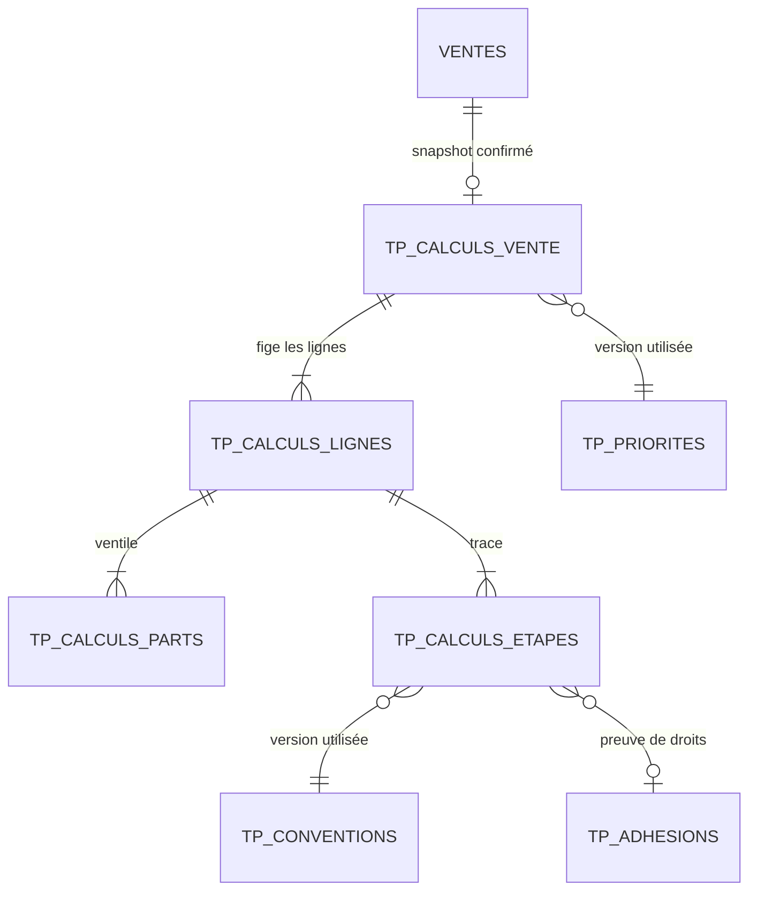

# P5-B.2 — Projection, snapshot et parcours Vente

## Modèle



Les tables sont `tiers_payant_calculs_vente`, `tiers_payant_calculs_lignes`,
`tiers_payant_calculs_parts` et `tiers_payant_calculs_etapes`. Chaque vente
admet au plus un snapshot confirmé. Les montants sont des entiers XAF; les
contraintes de ligne et d'en-tête vérifient les égalités. Les lignes, parts,
étapes et en-tête sont append-only, protégés par triggers PostgreSQL et SQLite.
Des index uniques partiels limitent chaque ligne à une part client et à une part
par organisme; le rang d'étape est également unique par ligne.
La confirmation vérifie l'équilibre complet avant insertion et écrit toutes
les tables dans la transaction/idempotence de l'opération applicative.

## Schéma JSON contractuel pris en charge

`conditions` est réservé. Il doit être `{}` ou `{"schema_version": 1}`; aucune
condition d'éligibilité libre n'est déduite de ce document. Toute autre clé ou
version bloque.

`extensions_p5b` doit avoir exactement les clés suivantes:

```json
{
  "schema_version": 1,
  "baremes": [{
    "code": "CODE_CONTRACTUEL",
    "taux_numerateur": 80,
    "taux_denominateur": 100,
    "plafond_ligne_xaf": 12000,
    "produits_ids": [],
    "categories_ids": ["uuid-ou-code-categorie"],
    "arrondi": "PLANCHER"
  }],
  "exclusions": {"produits_ids": [], "categories_ids": []}
}
```

`plafond_ligne_xaf` est facultatif; les autres propriétés d'un barème sont
requises. `arrondi` peut être `null` uniquement si tous les calculs applicables
sont entiers; les autres valeurs acceptées proviennent de `ModeArrondi` du
moteur P5-B.1. Les plafonds cumulés/périodiques, franchises, exclusions
conditionnelles, effets de cumul et priorités de barèmes chevauchants ne sont
pas définis et sont refusés ou bloqués; aucun défaut implicite n'est appliqué.

Les clés non reconnues dans `conditions`, `extensions_p5b`, exclusions ou
barèmes lèvent un blocage métier (HTTP 422). La convention et le paramétrage
P5-A utilisés, leurs versions, les adhésions/révisions vérifiées et les étapes
de calcul sont recopiés dans le snapshot. Un changement ultérieur n'altère pas
le résultat enregistré.

## API et transaction

- `POST /api/tiers-payants/organisations/{org}/ventes/{vente}/prise-en-charge/simuler`
  calcule sans écrire et renvoie `creance_creee: false`.
- `POST .../confirmer` accepte une vente transmise, une révision et un
  bénéficiaire explicitement sélectionné. Le verrou de ligne et le verrou
  d'organisation/idempotence P4 protègent contre les modifications et doubles
  confirmations; toute erreur annule l'écriture entière.
- `GET .../prise-en-charge` retourne le snapshot autorisé du site courant.

La préparation existante permet désormais la validation/transmission d'un mode
tiers seulement avec `tiers_payant.consulter`. Le panneau existant de préparation
permet de choisir le bénéficiaire, simuler, consulter les parts par vente/ligne
et confirmer le snapshot après transmission. L'encaissement final P4 continue
de refuser les modes tiers: tant que le rapprochement P5-C des créances et la
règle d'acquisition de fidélité sur les parts couvertes ne sont pas définis,
aucun reçu payé, mouvement de caisse, point ou créance ne doit être fabriqué.

La confirmation est idempotente par clé P4: même clé/contenu retourne le
résultat d'origine; contenu différent est un conflit. Une autre clé pour une
vente déjà confirmée est refusée par l'unicité en base. Les contraintes
organisationnelles couvrent vente/site, bénéficiaire, paramétrage, auteur,
ligne, organisme, convention et adhésion.
