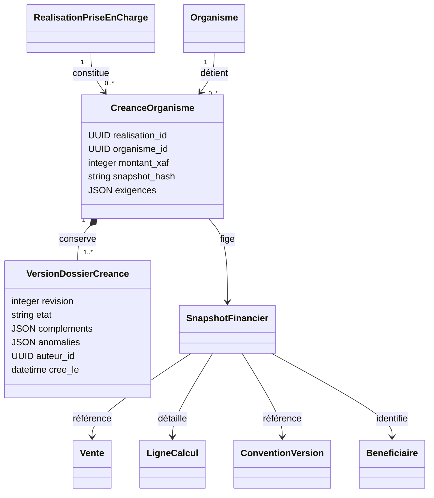
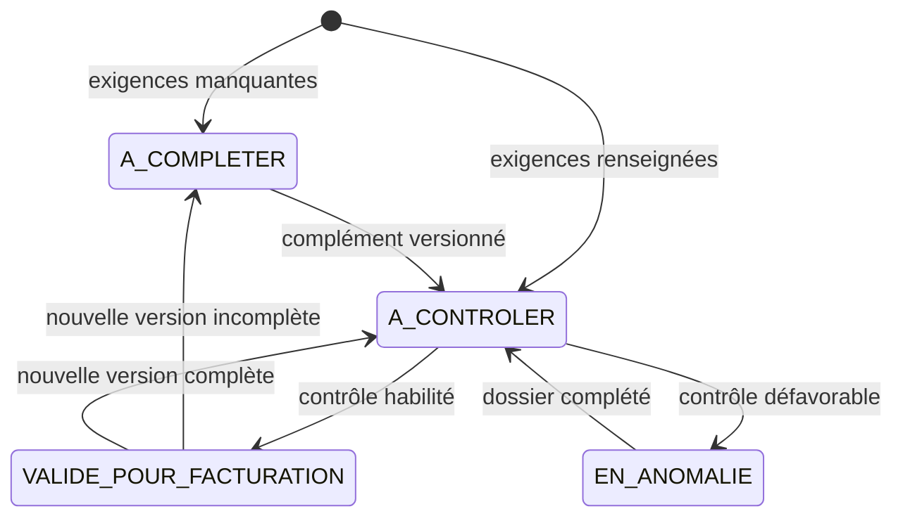

# P5-C.1 — Créances organismes et P5-FAC-02

Base exacte : `ba570569bb7063bf587ffac45c3eceff58dea93b` (arbre `b5c3af66c556c76bbf47ef859253b8c541e4e676`). Reprise depuis les bundles livrés, sans appliquer les patchs alternatifs. Copie isolée `work/p5-c-1-creances` ; aucune modification distante.

## Complément du référentiel UML

Le PDF consolidé du 18/10/2026 reste conservé. Cet addendum implémente les relations P5-FAC-01 et ajoute la décision P5-FAC-02 du propriétaire. Il ne réécrit pas le document historique.

Le détail par ligne, adhésion, bénéficiaire, convention/version, régime et preuve est repris dans le snapshot, avec les identifiants des lignes/parts/étapes P5-B. Aucune deuxième ventilation financière. Une créance positive par réalisation et organisme ; une réalisation peut ainsi constituer plusieurs créances. Le reçu et l'encaissement restent référencés via la réalisation d'origine.

`FACTURE` est réservé au futur module, sans transition publique dans P5-C.1. Tout retour P4 sur la vente impose un état effectif `EN_ANOMALIE`, même si une version administrative antérieure était validée. Les retours et remboursements restent consultables et immuables ; aucun solde organisme n'est diminué arbitrairement. Le futur registre compensatoire devra traiter ces montants avant engagement.

## P5-FAC-02 — séparation des contrôles

Les définitions de champs et justificatifs acceptent `finalite: FINANCIERE | FACTURATION`. L'absence de ce champ signifie **FINANCIERE** : les conventions historiques ne sont pas affaiblies. La définition contractuelle est versionnée, jamais modifiée sur place. Les groupes de pièces alternatives ne peuvent pas mélanger les deux finalités.

Les exigences financières, droits, périodes, éligibilité, adhésions et références de vérification restent contrôlés avant la confirmation. Seuls les renseignements explicitement marqués FACTURATION peuvent manquer à ce stade. Une preuve manuelle de droits reste nécessaire pour les conventions configurées : ce n'est pas une pièce administrative facultative.

Une créance incomplète peut être constituée après encaissement confirmé. Les compléments ne modifient jamais la preuve financière figée ni les montants. Le service refuse la substitution de champs ou pièces financiers depuis l'écran administratif. Toute modification administrative ajoute une version et annule l'admissibilité précédente jusqu'au contrôle explicite. Un dossier historique sans exigences documentaires figées reste non facturable (`EXIGENCES_DOCUMENTAIRES_NON_DEFINIES`) ; sa reprise exige une procédure ultérieure explicite, pas une invention de clauses.

## Transactions et accès

Les mutations passent par `StockService.operation` : verrou d'organisation partagé avec caisse/retours, empreinte du contenu, clé d'idempotence et commit unique. Un échec annule créances, versions, événements et registre d'opération. Les révisions sont vérifiées après acquisition du verrou. La contrainte UNIQUE source/organisme et celle créance/révision complètent ces contrôles. Les triggers interdisent UPDATE/DELETE des deux nouveaux journaux.

Les permissions `tiers_payant.creance.consulter`, `.constituer`, `.completer`, `.verifier` sont distinctes, sans attribution automatique. Les opérateurs de mutation doivent également pouvoir consulter le dossier retourné. Chaque opération contrôle organisation, site et emplacement de la vente ; le contrôle de périmètre précède aussi les rejeux. Authentification et CSRF P1 restent inchangés.

## API

Préfixe `/api/tiers-payants/organisations/{organisation_id}/creances`, contexte `X-Site-ID` et emplacement selon les conventions existantes.

| Méthode / suffixe | Contrat |
|---|---|
| GET `/sources`, GET `/` | Pagination serveur ; sources confirmées / créances ; filtre organisme sur créances |
| POST `/` | `cle`, `realisation_id` ; constitution de toutes les créances de la réalisation |
| GET `/{id}`, `/{id}/historique` | Détail et versions paginées |
| POST `/{id}/complements` | `cle`, `revision`, `complements`, `motif` ; nouvelle version complète des ajouts |
| POST `/{id}/verifier` | `cle`, `revision`, `conforme`, `motif` ; contrôle explicitement habilité |
| POST `/{id}/controle-engagement` | `cle`, `revision`, `operation` ; vérification informative, sans facture créée |

`complements` est un dictionnaire par identifiant de configuration figée, contenant `valeurs` et `documents`. Les documents portent `code`, `reference`, `verifie`. Les exigences sont retournées dans le détail pour générer les formulaires.

Les opérations d'engagement prévues sont `PRESENTER`, `GENERER_FACTURE`, `VALIDER_FACTURE`, `EMETTRE_FACTURE`. Toutes sont refusées si le dossier n'est pas complet, explicitement vérifié, à la bonne révision et sans retour à régulariser. **Le futur module devra appeler `CreanceService.autoriser_engagement` dans sa propre transaction, avant chaque action. Le résultat HTTP ne constitue pas un jeton durable.** Aucun endpoint d'émission de facture n'existe encore : les tests couvrent le garde serveur, pas une génération de facture inexistante.

## Migration

`20261019_05` dépend uniquement de `20261019_04`. Deux tables additives, FK organisationnelles, FK composite vers la réalisation exacte (vente/site inclus), clés uniques, montants positifs, états et révisions bornés. Une contrainte UNIQUE composite est ajoutée aux réalisations ; les triggers source sont réinstallés après reconstruction SQLite. Aucun changement de migration historique. Downgrade refusé dès qu'une créance ou version existe ; sans données nouvelles, les tables et la contrainte source sont retirées. Les permissions éventuellement attribuées ne sont pas supprimées.

## Limites délibérées

Pas de présentation effective, facture, bordereau, règlement organisme ou régularisation de créance comptabilisée. Les états correspondants seront ajoutés avec leurs journaux lors des incréments dédiés. Les plafonds consommables restent non arbitrés. Le dossier documentaire conserve des références, sans stockage ou téléversement de pièces binaires dans cet incrément. Les sources sans configuration historique ne peuvent pas être déclarées facturables par simple clic.
