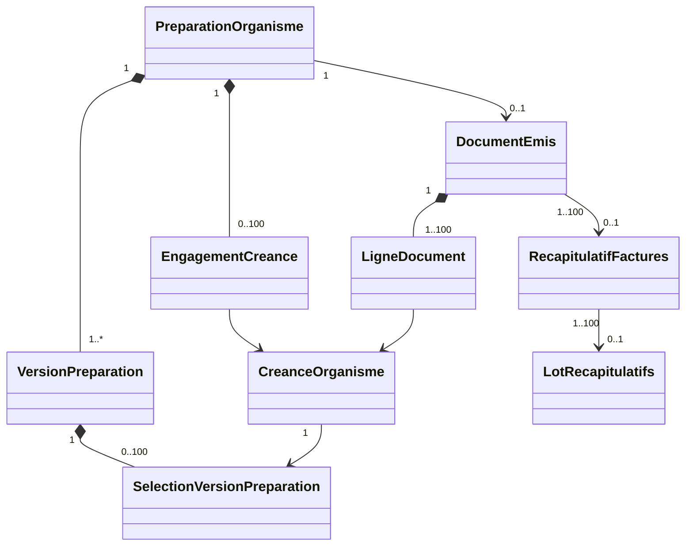

# Documents organismes — conception et contrat livré

Livraison locale du 19 octobre 2026, depuis P5-C.1 `b8ddf845695f1e82a8d1cbcf0b06e42824bf2133`. Branche `work/p5-c-2-facturation`. État : **partiel, émission de production interdite**. Les sources financières P4/P5-B et le garde administratif P5-C.1 sont réutilisés, sans changement de leurs règles.

## Références et décisions isolées

Le bundle P5-C.1 a été vérifié et le commit/arbre concordent avec son manifeste. Le patch déjà intégré n'a pas été appliqué de nouveau. Le référentiel UML consolidé consulté sépare Créance, Présentation, Facture et Règlement/Affectation ; les sections relatives aux regroupements ne fixent pas une obligation de récapitulatif/lot pour toute facture. Aucun taux fiscal, mention légale gabonaise ou compteur définitif n'a été déduit de ce silence.

La décision définitive de numérotation et de conformité est encore nécessaire. Ce lot fournit une **référence manuelle de recette**, unique par organisation et genre, attribuée uniquement à l'émission isolée. Le protocole de recette est obligatoire, et chaque page porte « RECETTE ISOLEE - SANS VALIDITE FISCALE ». Cette convention technique n'est pas une politique de facturation de production.

Période : dates inclusives des réalisations en UTC, affichées comme telles ; confirmer la période contractuelle et le fuseau avant activation réelle. Une préparation contient un organisme, un site et une version de convention. Le regroupement intersites/multiconventions, les rejets et nouvelles présentations ne sont pas introduits faute de règles suffisantes.

## Modèle UML livré

`PresentationCreance` est matérialisée par une préparation BORDEREAU, ses engagements et son document émis. `FactureOrganisme` utilise le même en-tête typé FACTURE, puis ses lignes immuables. Une facture peut référencer une préparation BORDEREAU déjà émise ; son snapshot conserve l'ID du document bordereau. `RecapitulatifFactures` et `LotRecapitulatifs` partagent une table typée avec membres explicites. Aucune de ces agrégations ne crée un mouvement financier ni un règlement organisme.

| Élément | Persistance et garantie |
|---|---|
| Préparation | En-tête immuable, organisation/site/organisme/convention/période/auteur |
| Versions | Append-only ; révision unique ; sélection, motif, auteur et date |
| Engagement | UNIQUE créance/genre ; libération seulement avant émission ; mise à jour interdite |
| Document émis | Une émission par préparation ; référence unique organisation/genre ; PDF binaire, SHA-256 et snapshot figés |
| Lignes | UNIQUE créance/genre ; FK organisationnelles ; montants sources conservés |
| Regroupements | Facultatifs, même site et organisme ; aucun doublon de facture ou récapitulatif |
| Index des sélections | Relation version/créance immuable ; filtrage des accès historiques avant pagination |

Les totaux agrégés utilisent BIGINT et une somme Python entière bornée à 64 bits. Aucun flottant ni arrondi fiscal ajouté. Les montants unitaires des créances restent les montants historiques P5-C.1.

## États et opérations

PREPARATION → VALIDEE → EMISE. Une modification ou un retrait produit une nouvelle version PREPARATION et invalide la validation précédente. L'abandon produit ABANDONNEE et libère les engagements, sans supprimer les versions. Une préparation vide après retrait peut subsister mais ne peut être validée ni prévisualisée/émise.

Chaque constitution, prévisualisation, validation et émission appelle le garde P5-C.1 `autoriser_engagement`. Les informations financières indispensables restent obligatoires au comptoir. Les compléments administratifs sont saisis/vérifiés via P5-C.1. Un complément modifié après validation, un retour, une révision périmée ou une incohérence bloque l'engagement côté serveur.

Après émission d'une facture de recette, une nouvelle version administrative FACTURE est ajoutée aux créances ; aucun montant ni snapshot financier n'est réécrit. Un retour postérieur bloque aussi la création d'un récapitulatif et d'un lot. Les factures existantes restent consultables et inchangées. Les compensations et avoirs sont un sous-lot distinct, encore bloquant pour ces dossiers.

## Transactions et sécurité

Les mutations passent par `StockService.operation` : transaction unique, registre d'idempotence existant, verrou organisationnel pris dans un ordre commun, contrôles de révision et audit. Les versions, engagements, lignes, PDF, état FACTURE et audit sont validés ensemble. Une exception annule le tout. Le PDF est stocké dans la base, sans publication de fichier externe avant commit. L'organisation est sérialisée à ce stade ; coût de contention à mesurer en recette native.

Les contraintes d'unicité sont des barrières supplémentaires. La sûreté concurrente PostgreSQL n'est pas considérée comme démontrée par SQLite. Les tests natifs synchronisent deux opérateurs habilités, deux PID et deux transactions, observent `pg_blocking_pids`, et bornent les attentes.

Permissions nouvelles, sans attribution à un rôle : `tiers_payant.document.consulter`, `.preparer`, `.valider`, `.emettre`, `.regrouper`. Elles s'ajoutent aux droits de consultation des créances et au périmètre P1 organisation/site/emplacement. Les droits sur toutes les sources historiques sont revérifiés, même si une créance a été retirée. Les contrôles de droits précèdent également le rejeu d'une mutation. Authentification, CSRF et refus des champs supplémentaires sont ceux de P1/P4.

## API

Préfixe `/api/tiers-payants/organisations/{organisation_id}/documents`. En-têtes de site/emplacement et CSRF selon les conventions existantes. Toute mutation exige `cle` UUID et un motif ; celles d'une préparation existante exigent `revision`.

| Méthode / suffixe | Contrat |
|---|---|
| GET `/activation` | Autorisation d'émission de recette ; production toujours false |
| GET `/organismes` | Recherche nom/code, page/page_size, périmètre autorisé |
| GET `/creances` | organisme_id, statut effectif, date_debut/date_fin UTC, pagination serveur |
| GET/POST `/preparations` | Liste / création ; genre, organisme, convention, période, sélection `{creance_id,revision}`, presentation_id facultatif |
| GET `/preparations/{id}` | État/version courante et document éventuel |
| POST `/preparations/{id}/selection` | Remplacement explicite, retrait possible ; version requise |
| POST `/preparations/{id}/valider` | Recontrôle complet et nouvelle version VALIDEE |
| POST `/preparations/{id}/abandonner` | Libération sans émission |
| POST `/preparations/{id}/emettre` | Garde + référence manuelle de recette + reference_validation ; refus hors contexte jetable |
| GET `/preparations/{id}/historique` | Versions paginées |
| GET `/preparations/{id}/previsualisation.pdf` | Révision requise, garde FAC-02, BROUILLON NON EMIS |
| GET `/emis/{id}/pdf` | Octets du PDF figé, jamais recalculés depuis données courantes |
| GET/POST `/regroupements` | Liste / création RECAPITULATIF ou LOT, `ids` explicites, motif |
| GET `/regroupements/{id}` et `/pdf` | Snapshot historique et PDF figé |

Les listes prennent `page` et `page_size` (maximum 100, UI 25). Les préparations peuvent être filtrées par organisme/genre/creance_id ; les regroupements par organisme/genre/document_id. Les liens permettent de parcourir créance → préparations/documents → récapitulatifs/lots. Un conflit 409 demande rechargement, sans correction silencieuse de la sélection. Référence dupliquée, double engagement, droits insuffisants et périodes invalides donnent des refus contrôlés.

## Interface et activation

Module intégré Créances : recherche/contrôle, compléments existants, sélection, préparation, reprise, retrait, abandon, prévisualisation, validation, historique, téléchargement des pièces et regroupements facultatifs. Recherche des organismes par nom/code paginée. La sélection de créances survit à la pagination et est effacée au changement de filtres/contexte. Double clic bloqué ; même corps/même tentative après perte réseau réutilise la clé. Le serveur reste l'autorité pour état, droits et montants.

L'émission ne peut être ouverte que si toutes les conditions sont vraies : `CI=true`, `P5C2_DISPOSABLE_EMISSION=1`, moteur PostgreSQL réel, hôte local, base `neosys_p4p5_*`, confirmation exacte `P4P5_CONFIRM_DATABASE`, identité SQL concordante et commentaire `NEOSYS_P4P5_DISPOSABLE`. Aucun flag de requête client n'est accepté. Les tests SQLite substituent explicitement ce garde uniquement pour tester l'orchestration, jamais comme preuve native. `GROUPED_ENCASHMENT_ENABLED` et les écrans vente/caisse ne sont pas modifiés.

## Migration

`20261019_06` dépend de `20261019_05` : huit tables, FK composites organisationnelles, contraintes/index et triggers d'immuabilité. Aucun changement des migrations historiques ni des tables financières existantes. Downgrade vers 05 autorisé seulement si les huit tables sont vides ; sinon refus explicite pour préserver les données. Les permissions ne sont attribuées à aucun utilisateur. La migration ne doit être appliquée ici qu'à une base jetable neuve.
